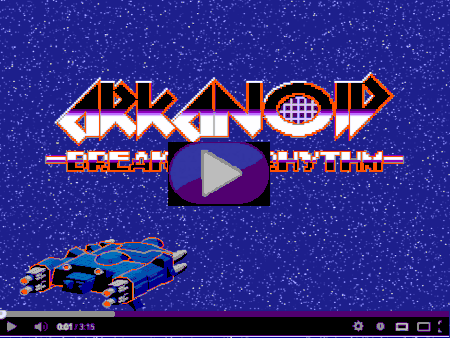

# Arcanoid

A Breakout-style game written in **C++17**, with **SFML** for graphics, input and audio, and **Box2D** for physics. The project includes a level editor, a campaign with unlockable levels, and configurable ball, paddle and background appearances.

Beyond the gameplay, the project focuses on object ownership, state-based application design, a fixed-step physics simulation and regression testing.

[Watch the gameplay video](https://youtu.be/i0wfcGx4zOw) · [Build instructions](#build-and-run) · [Controls](#controls) · [Architecture](#architecture)

[](https://youtu.be/i0wfcGx4zOw)

## Features

- **Seven included levels**, with progression that unlocks the next available map.
- **An integrated level editor** for placing and removing blocks, choosing block types and durability, and saving or loading maps.
- **Three block types:** destructible, indestructible and power-up blocks.
- **Seven power-ups:** larger or smaller paddles, additional balls, faster or slower balls, and temporarily reversed controls.
- **A complete game flow:** main menu, level selection, settings, pause menu, victory and defeat screens.
- **Appearance and audio settings:** ball and paddle variants, backgrounds, resolution and separate music, collision and end-game volume controls.
- Block destruction animations, a gameplay timer and a three-life system.

## Technical highlights

- **RAII and explicit ownership.** States, game entities and UI controls use `std::unique_ptr`. Physics entities release their Box2D bodies when destroyed, and the world outlives its entities.
- **Physics independent of rendering.** An accumulator advances Box2D at 60 simulation steps per second. Pausing freezes simulation, gameplay time and timed effects.
- **Consistent input handling.** Keyboard and mouse state are sampled once per frame; button clicks and keyboard actions distinguish a new press from a held input.
- **Validated map loading.** Maps are checked for malformed records, invalid dimensions, out-of-range coordinates and duplicate tiles before replacing the open level.
- **Reproducible builds and checks.** CMake builds the game and its regression tests. A GitHub Actions workflow builds and tests on Ubuntu with AddressSanitizer and UndefinedBehaviorSanitizer.

## Build and run

### Requirements

- A C++17 compiler
- CMake **3.20 or newer**
- SFML **2.5 or 2.6**, including graphics, window, system and audio components
- Box2D **2.4**
- A graphical desktop session to run the game

The current build and regression suite have been verified on **Ubuntu 24.04 with GCC 13, SFML 2.6.1 and Box2D 2.4.1**. SFML 3 and Box2D 3 use different APIs and are not supported by this codebase.

### Ubuntu

Install the dependencies:

```bash
sudo apt update
sudo apt install build-essential cmake libsfml-dev libbox2d-dev
```

Clone the project and build it:

```bash
git clone https://github.com/MateuszAmbrozy/Arcanoid.git
cd Arcanoid
cmake -S . -B build-linux -DCMAKE_BUILD_TYPE=Release
cmake --build build-linux --parallel
./build-linux/arcanoid
```

CMake copies the resources, fonts, configuration and maps next to the executable. Keep those files together when moving a build. The game looks for its assets beside the executable or in the project directory.

### Windows

The repository also contains a Visual Studio solution and bundled Windows dependencies from the original project. The refactored code targets C++17; the current Visual Studio project uses the `v143` toolset. **The Windows build has not yet been revalidated after the refactor.**

## Controls

### Gameplay

| Input | Action |
| --- | --- |
| **A / D** | Move the paddle; movement also launches the ball at the start of a life |
| **Esc** | Pause or resume |
| **Left mouse button** | Use menu buttons |

Destroy every destructible block to complete a level. Catch falling power-ups with the paddle. Losing the last active ball costs one life; losing all three ends the game.

### Level editor

Choose **EDITOR** from the main menu, select a level slot, then choose **EDIT**. Existing maps are loaded automatically; unused slots open an empty map.

| Input | Action |
| --- | --- |
| **Left mouse button on the palette** | Choose a block appearance |
| **Left mouse button on the map** | Place blocks |
| **Right mouse button** | Remove blocks |
| **Up / Down** | Change the block type |
| **Page Up / Page Down** | Increase or decrease block durability |
| **Esc** | Open or close the editor menu, including **SAVE**, **LOAD** and **QUIT** |

Maps use the text-based `.slmp` format. The editor can use 16 numbered slots; the included maps are `1`, `2`, `3`, `4`, `7`, `10` and `11`. Campaign progression skips missing maps.

Keyboard bindings are defined in [`Arcanoid/Config`](Arcanoid/Config).

## Architecture

| Component | Responsibility |
| --- | --- |
| [`Game`](Arcanoid/Game.cpp) | Window lifecycle, frame input, application loop and ownership of the state stack |
| [`State`](Arcanoid/State.h) and derived states | Shared state interface, menus, settings, level selection, gameplay and editing |
| [`GameState`](Arcanoid/GameState.cpp) | Fixed-step simulation, lives, pause handling and level transitions |
| [`Ball`](Arcanoid/Ball.cpp), [`Paddle`](Arcanoid/Paddle.cpp), [`Block`](Arcanoid/Block.cpp) | Visual entities and the lifetime of their corresponding physics bodies |
| [`ContactListener`](Arcanoid/ContactListener.cpp) | Box2D collision callbacks and entity contact flags |
| [`BlockSet`](Arcanoid/BlockSet.cpp) | Map instances, block destruction, animations and power-ups |
| [`MapFile`](Arcanoid/MapFile.h) and [`LevelCatalog`](Arcanoid/LevelCatalog.h) | Map parsing and validation, level discovery and progression |
| [`Gui`](Arcanoid/Gui.cpp) | Buttons, dropdowns, texture selection, sliders and progress bars |
| [`GameConfig`](Arcanoid/GameConfig.h) | Shared gameplay, grid and physics constants |

## Tests

The regression suite covers:

- Graphics configuration round-trips and rejection of invalid settings.
- Parsing all included maps and rejecting malformed or duplicate tile records.
- Saving and reloading editor maps without losing their data.
- Releasing physics bodies when entities and maps are destroyed.
- Matching ball trajectories at **30, 60, 75 and 144 rendering FPS**.
- Pausing, resuming, losing lives, unlocking levels, the **NEXT** action and the final victory screen.
- Repeated settings application while preserving appearance selections.

After building, run the tests from a desktop session:

```bash
ctest --test-dir build-linux --output-on-failure
```

For a headless Linux environment, use a virtual display:

```bash
sudo apt install xvfb
xvfb-run -a ctest --test-dir build-linux --output-on-failure
```

To enable memory and undefined-behavior checks with GCC or Clang:

```bash
cmake -S . -B build-sanitized \
  -DCMAKE_BUILD_TYPE=Debug \
  -DARCANOID_SANITIZERS=ON
cmake --build build-sanitized --parallel
ASAN_OPTIONS=detect_leaks=1 xvfb-run -a \
  ctest --test-dir build-sanitized --output-on-failure
```

Tests use a silent OpenAL backend. They exercise audio-related code paths but do not verify audible playback.

## Screenshots

<details>
<summary>Main menu, settings, gameplay and editor</summary>

### Main menu


### Settings


### Gameplay


### Level editor


</details>

## Project status

The Linux Release build and the sanitizer-enabled regression suite pass locally. Automated Linux checks are defined in [`.github/workflows/build.yml`](.github/workflows/build.yml).

Remaining repository work includes documenting the sources and licenses of the graphics, audio and fonts, and revalidating the Windows build. The repository does not currently include a project license file.
